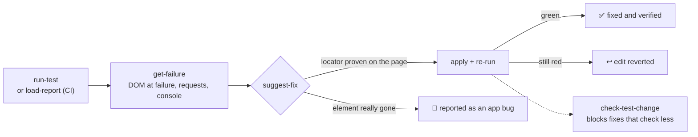

<p align="center">
  
</p>

<h1 align="center">playwright-e2e-mcp</h1>

<p align="center"><b>The test doctor for AI agents.</b><br>
Your Playwright test fails. Your AI finds out why, fixes it, and <b>proves the fix works</b>, or tells you it's a real bug.</p>

<p align="center">

[](https://www.npmjs.com/package/playwright-e2e-mcp) [](https://www.npmjs.com/package/playwright-e2e-mcp) [](https://github.com/xsignon-secure/E2E/actions/workflows/ci.yml) [](https://registry.modelcontextprotocol.io/) [](LICENSE) [](#-free-and-open-source)

[](https://cursor.com/en/install-mcp?name=playwright-e2e&config=eyJjb21tYW5kIjoibnB4IiwiYXJncyI6WyIteSIsInBsYXl3cmlnaHQtZTJlLW1jcCJdfQ==)
[](https://insiders.vscode.dev/redirect?url=vscode%3Amcp%2Finstall%3F%257B%2522name%2522%253A%2522playwright-e2e%2522%252C%2522command%2522%253A%2522npx%2522%252C%2522args%2522%253A%255B%2522-y%2522%252C%2522playwright-e2e-mcp%2522%255D%257D)
[](https://github.com/xsignon-secure/E2E/releases/latest)

</p>

<p align="center">
  
</p>

<p align="center">⭐ <b>If it saves you a debugging session, <a href="https://github.com/xsignon-secure/E2E">a star</a> helps other Playwright users find it.</b></p>

<p align="center">
  <a href="#-quick-start">Quick start</a> ·
  <a href="#-what-you-get">Features</a> ·
  <a href="#-tools">Tools</a> ·
  <a href="docs/tools.md">Tool reference</a> ·
  <a href="#-ci-github-action-gitlab-and-any-ci">GitHub Action</a> ·
  <a href="#-benchmark">Benchmark</a> ·
  <a href="https://github.com/xsignon-secure/E2E/releases">Changelog</a>
</p>

An [MCP](https://modelcontextprotocol.io) server and agent skill that gives Claude, Cursor,
VS Code Copilot, Codex, Gemini and any other MCP client a full Playwright toolkit: a **test
runner**, a **failure detective** and a **fixer that checks its own work**. Browser MCPs let an
AI click around a page. This one lets it **keep your test suite green**, for TypeScript and
Python suites, on your laptop and in CI. Free, MIT, no account.

## ❌ Without it / ✅ With it

**Without it**, your agent sees `Timeout 5000ms exceeded waiting for getByTestId('checkout')`,
guesses a new selector, edits the test and hopes. Or it "fixes" the test by deleting the
assertion that caught a real bug.

**With it**, your agent reads the page **as it was when the test failed** (from the Playwright
trace), swaps in a locator proven unique on that page, re-runs the test and keeps the edit only
if it passes. When the button is really gone, it says so: that's an app bug, not a test to patch.
And a heal guard blocks any "fix" that went green by checking less.



## ⚡ Quick start

Run this in your project root. It adds the server to every MCP client config it finds (Claude
Code, Cursor, VS Code, Gemini CLI, Codex), installs the agent skill and leaves your other servers
alone:

```bash
npx -y playwright-e2e-mcp init      # --client all | cursor,vscode … · --dry-run
npx -y playwright-e2e-mcp doctor    # checks Node, Playwright, browsers, client setup, tool token cost and updates
```

Then restart your client and ask:

```
Run my Playwright tests and fix whatever fails.
```

**Or let your agent install it.** Paste this into any coding agent:

> Install the playwright-e2e-mcp server and skill by following
> https://raw.githubusercontent.com/xsignon-secure/E2E/main/llms-install.md

**Or add the standard config** by hand (works in most clients):

```json
{
  "mcpServers": {
    "playwright-e2e": {
      "command": "npx",
      "args": ["-y", "playwright-e2e-mcp"]
    }
  }
}
```

**Needs:** Node.js 22+, and a project with `@playwright/test` and a browser
(`npx playwright install chromium`) or with [`pytest-playwright`](#-python-projects-pytest-playwright).
The server uses its working directory as the project root; if your client starts it elsewhere,
add `"env": { "PW_MCP_PROJECT_ROOT": "/path/to/your/project" }`.

<details>
<summary><b>Claude Code</b></summary>

Server and skill, as a plugin:

```
/plugin marketplace add xsignon-secure/E2E
/plugin install playwright-e2e-mcp@xsignon-secure
```

Or the server only:

```bash
claude mcp add playwright-e2e -- npx -y playwright-e2e-mcp
```

</details>

<details>
<summary><b>Claude Desktop</b></summary>

Download the `.mcpb` extension from the [latest release](https://github.com/xsignon-secure/E2E/releases/latest)
and double-click it. It ships its own dependencies, so no Node setup is needed. On install it
asks for your **project root**: choose the project folder, not your home directory.

You can also add the standard config to `claude_desktop_config.json`.

</details>

<details>
<summary><b>Cursor</b></summary>

Click [Install in Cursor](https://cursor.com/en/install-mcp?name=playwright-e2e&config=eyJjb21tYW5kIjoibnB4IiwiYXJncyI6WyIteSIsInBsYXl3cmlnaHQtZTJlLW1jcCJdfQ==),
or go to **Settings → MCP → Add new MCP server** and paste the standard config. For one
project only, put it in `.cursor/mcp.json`.

Only fixing failing tests? [Install the core tools only](https://cursor.com/en/install-mcp?name=playwright-e2e&config=eyJjb21tYW5kIjoibnB4IiwiYXJncyI6WyIteSIsInBsYXl3cmlnaHQtZTJlLW1jcCIsIi0tdG9vbHM9Y29yZSJdfQ==): the seven-tool fix loop
(`--tools=core`), about 2.4k tokens of tool definitions instead of 12.8k.

</details>

<details>
<summary><b>VS Code / GitHub Copilot</b></summary>

Click the **Install in VS Code** button above, or run:

```bash
code --add-mcp '{"name":"playwright-e2e","command":"npx","args":["-y","playwright-e2e-mcp"]}'
```

</details>

<details>
<summary><b>Codex</b></summary>

```bash
codex mcp add playwright-e2e -- npx -y playwright-e2e-mcp
```

A Playwright run with retries can take longer than Codex's default 60 s tool timeout. Raise
the timeouts in `~/.codex/config.toml`:

```toml
[mcp_servers.playwright-e2e]
command = "npx"
args = ["-y", "playwright-e2e-mcp"]
startup_timeout_sec = 60
tool_timeout_sec = 600
```

</details>

<details>
<summary><b>Gemini CLI / Qwen Code</b></summary>

Server and skill, as an extension:

```bash
gemini extensions install https://github.com/xsignon-secure/E2E
```

Or paste the standard config into `.gemini/settings.json` (Qwen Code: `.qwen/settings.json`).

</details>

<details>
<summary><b>Windsurf, Cline, Zed, Freebuff and other clients</b></summary>

Add the standard config to the client's MCP config file:

- **Windsurf**: `~/.codeium/windsurf/mcp_config.json`
  ```json
  { "mcpServers": { "playwright-e2e": { "command": "npx", "args": ["-y", "playwright-e2e-mcp"] } } }
  ```
- **Cline**: *MCP Servers → Configure* opens `cline_mcp_settings.json`
  ```json
  { "mcpServers": { "playwright-e2e": { "command": "npx", "args": ["-y", "playwright-e2e-mcp"] } } }
  ```
- **Zed**: `~/.config/zed/settings.json` (Zed calls MCP servers context servers)
  ```json
  { "context_servers": { "playwright-e2e": { "command": "npx", "args": ["-y", "playwright-e2e-mcp"] } } }
  ```

Freebuff / Codebuff: drop an `mcp.json` with the standard config into your project's `.agents/`
folder. This repo ships one in [`.agents/mcp.json`](.agents/mcp.json); Freebuff asks you to trust
a repository's `.agents/` on first run.

</details>

<details>
<summary><b>ChatGPT, claude.ai and other remote-only clients</b></summary>

Some clients only accept a remote HTTPS server. This repo ships a Streamable HTTP bridge you
can host for free on Vercel, with OAuth sign-in for claude.ai connectors (dynamic registration
and Client ID Metadata Documents). See [Hosted endpoint](docs/hosted-endpoint.md). On Vercel the
page tools (inspect a page, check selectors, accessibility and Web Vitals audits) run on a
bundled Chromium against public URLs. Running and fixing your own tests needs your project, so
use the local install for that.

</details>

<details>
<summary><b>Other ways to install: skill only, Docker, registry, tarball</b></summary>

| Route | How |
| --- | --- |
| Skill only, any agent | `npx skills add xsignon-secure/E2E` |
| MCP Registry | `io.github.xsignon-secure/E2E` ([listing](https://registry.modelcontextprotocol.io/)); registry-aware clients find it there |
| Docker | `docker run -i --rm -v "$PWD:/work" ghcr.io/xsignon-secure/playwright-e2e-mcp` (published on each release; see [Development](docs/development.md#docker)) |
| Straight from GitHub, no npm | `npx -y github:xsignon-secure/E2E#v0.16.2` (pin a release tag) |
| Release tarball | `npm install -D https://github.com/xsignon-secure/E2E/releases/download/v0.16.2/playwright-e2e-mcp-0.16.2.tgz` |
| Local checkout | `"command": "node", "args": ["/path/to/E2E/dist/index.js"]` |

</details>

<details>
<summary><b>Updating</b></summary>

| Installed with | To update |
| --- | --- |
| `npx -y playwright-e2e-mcp` (the setup above, and what `init` writes) | Restart your MCP client. npx (npm 10, which comes with Node 22) asks npm for the latest version on each launch and fetches it. |
| `npm install -D playwright-e2e-mcp` in the project | `npm install -D playwright-e2e-mcp@latest` |
| `npm install -g playwright-e2e-mcp` | `npm install -g playwright-e2e-mcp@latest` |
| GitHub Action `uses: xsignon-secure/E2E@v0.x.y` | Change the tag (Dependabot's `github-actions` updates do it for you) |
| Docker | `docker pull ghcr.io/xsignon-secure/playwright-e2e-mcp:latest` |
| Claude Desktop bundle (`.mcpb`) | Download the new bundle from the [latest release](https://github.com/xsignon-secure/E2E/releases/latest) and open it |
| Git clone | `git pull && npm ci` |
| Agent skill copied by `init` or `npx skills add` | Run the same command again |

`npx -y playwright-e2e-mcp doctor` tells you whether a newer version is out and prints the
command for your setup. Upgrade notes for each release are on the
[releases page](https://github.com/xsignon-secure/E2E/releases).

</details>

## 💬 What you can ask

| | You ask your AI… | It does this |
|---|---|---|
| 🏃 | "Run my tests" | Runs the suite and reports every failure with file, line, cause and a fix hint. One root cause breaking 30 tests shows up as **one** problem. |
| 🔍 | "Why did this fail?" | Reads Playwright's trace: the page at the moment of failure, the broken request, the console error. No guessing. |
| 🛠️ | "Fix it" | Swaps in a locator proven unique on that page, **re-runs the test** and undoes the edit if it's still red. If the element is really gone, it tells you it's an app bug. |
| ☁️ | "Why did CI fail?" | Loads the CI job's report (sharded blob reports too) and its traces, so the same diagnosis and fixes work on CI failures. |
| 🎲 | "Is this test flaky?" | Re-runs it with retries off, alone and in shuffled order, and names the race, the shared state or the **test it depends on**, with the seed that reproduces it. |
| 🎯 | "Which commit broke this?" | Bisects git history in a throwaway worktree and names the first bad commit, its diff and the failure there. |
| 📈 | "What's been breaking lately?" | Ranks flaky, newly broken and slow tests from the run history and names the commit where each went bad. |
| 🧊 | "Quarantine this flaky test" | Keeps it running and reported but stops it failing the build, with an owner and an expiry date. |
| 🛡️ | "Did that fix cheat?" | Compares the changed tests with git and blocks a fix that passes by deleting assertions, skipping tests or adding `.only`. |
| ✍️ | "Write a test for this flow" | Walks the steps on the live page, writes a spec with real locators and assertions on where the flow landed, and runs it once to prove it passes. |
| 🔑 | "Log in and save the session" | Signs in once, **2FA codes included** (generated from your TOTP secret), checks the session and saves it. The password never passes through the chat. |
| ♿ | "Check this page for accessibility" | Runs axe-core (WCAG 2.2 AA) and returns each problem with a verified locator and a ready regression test. |
| ⚡ | "Why is this page slow?" | Measures Web Vitals (LCP, CLS, INP, TBT) on desktop or a throttled phone, names the slow and shifting elements, and hands back a budget test. |
| 🐍 | "Run my pytest suite" | Runs `pytest-playwright` projects with the same failure diagnosis and traces. |

## ✨ What you get

### 🩺 A fix loop that proves itself

- **Fixes are verified, not guessed.** `suggest-fix` picks a locator proven unique on the DOM at
  failure, writes it, re-runs the test and reverts if it's still red. Strict-mode violations get
  the locator of the intended match; changed copy gets the new expected text.
- **Honest about real bugs.** When the element is really gone, it refuses to patch the test and
  reports an app bug.
- **Heal guard.** `check-test-change` (and `playwright-e2e-mcp guard` in CI) blocks a "fix" that
  went green by deleting an assertion, skipping the test, adding `.only`, swallowing the error or
  moving an assertion under an `if`, and warns on weaker matchers, hard waits, forced clicks,
  early returns and raised timeouts. `runtime: true` also runs the old and new version and blocks
  a test that now **executes fewer assertions**, which catches what no code scan can. Works for
  pytest-playwright files too.
- **Asks before it writes.** Applying a fix, writing a test, quarantining or replacing a visual
  baseline shows you the exact diff and waits for your yes in clients that support MCP
  questions (`PW_MCP_CONFIRM_WRITES`).

### 🔬 Flaky tests, history and the breaking commit

- **Flaky verdicts with evidence.** `diagnose-flaky` tells a race from shared state from a
  **test-order** dependency, and gives the seed that replays it.
- **Quarantine with an owner and an expiry.** The test keeps running and being reported; it stops
  blocking the build until the date you set.
- **Memory of every run.** `analyze-history` ranks flaky, regressed, broken and slow tests and
  names the commit where each went bad. Share one history across every CI job and laptop with the
  free, [self-hosted history server](history-server/README.md) (one `docker run`, dashboard included).
- **`bisect-failure`** finds the first bad commit without touching your checkout.
- **`audit-tests`** finds flake risks in the test code (hard waits, one-shot assertions, missing
  `await`s, fragile selectors, clicks right after `goto` on a server-rendered app), ranks them by
  real flakiness and applies the safe rewrites with a verifying run.

### ⚡ Hydration races and stale mocks

- **The "too fast" click.** On Next.js, Nuxt, Remix, Astro and other server-rendered apps the HTML
  is clickable before JavaScript attaches its handlers, so a test clicks, the step passes and
  nothing happens. `inspect-page` names the framework and measures how long controls were on
  screen before hydration; `get-failure` and `diagnose-flaky` flag a click made while the page's
  scripts were still downloading and hydration errors in the console; each comes with the wait
  to add.
- **Mocks that drifted from the API.** `check-mocks` (and `playwright-e2e-mcp mocks` in CI) finds
  every `route.fulfill` JSON body and `routeFromHAR` recording, calls the real endpoint (GET only)
  and reports the fields the mock relies on that the API no longer sends, changed types, new
  nulls and removed endpoints, so a green suite stops hiding a broken contract.

### 🔗 CI runs by URL, remote browsers, Python fixes and AI chat UIs

- **Paste the CI run, skip the download.** Give `load-report` a GitHub Actions run or GitLab job
  URL. It fetches the report and traces with your own `GITHUB_TOKEN` / `GITLAB_TOKEN`, maps them
  onto your checkout, and `get-failure` and `suggest-fix` work on that run.

  ```json
  { "report": "https://github.com/acme/shop/actions/runs/123456789" }
  ```

- **Any browser, anywhere.** The page tools take `connect`: a Playwright server
  (`npx playwright run-server`), a browser grid or device cloud, or a Chrome over CDP. Keys stay
  in the environment as `{{env:…}}`, never in chat, and only go to hosts you named in
  `PW_MCP_CONNECT` or `PW_MCP_CONNECT_HOSTS`.

  ```json
  { "url": "https://staging.example.com", "connect": "wss://grid.example.com/playwright?key={{env:E2E_GRID_KEY}}" }
  ```

- **Fixes for pytest suites.** `suggest-fix` now patches `test_*.py` files in Python syntax and
  re-runs the test with pytest before keeping the change:

  ```diff
  - page.get_by_test_id("checkout-button").click()
  + page.get_by_role("button", name="Checkout").click()
  ```

- **AI chat and streaming UIs.** The agent skill shows how to test answers that stream in: mock
  the model's stream, wait for the "done" signal instead of the text, and check shape rather than
  exact wording against a live model.

  ```ts
  await expect(page.getByRole('button', { name: 'Stop' })).toBeHidden();
  await expect(page.getByTestId('message').last()).toHaveText('Hello, world!');
  ```

### 🤖 CI that comments with working fixes

- **GitHub Action** that writes the diagnosis to the job summary, keeps one PR comment up to date
  and posts each verified fix as a **suggested change** reviewers apply with one click.
- **CI templates** for GitHub Actions, GitLab, Azure DevOps, CircleCI, Bitbucket and AWS CodeBuild, and a plain `ci` command for anything else.
- **Diagnose CI locally:** `load-report` maps a CI job's report and traces onto your checkout.

### 🌐 Page tools with locators that already work

- **`inspect-page`** returns a compact map of verified Playwright locators (about **570 tokens**
  for a storefront page, against 2,300 for a Playwright MCP snapshot), or the full DOM inventory,
  or the accessibility snapshot with a ready `toMatchAriaSnapshot` assertion.
- **Reaches the hard screens:** saved logins, headers, click and fill steps, popups and new tabs,
  API mocks (500s, empty lists, slow calls), HAR record and replay, phone and tablet presets,
  Chromium, Firefox, WebKit, Chrome and Edge.
- **Look without changing anything:** `blockWrites` stops POST, PUT, PATCH and DELETE requests
  from reaching a real backend, and `blockResources` skips images, fonts and trackers for faster,
  private page checks. `offline: true` cuts the network after load to test offline states.
- **Accessibility, Web Vitals and visual diffs** that return locators and ready tests, not just a score.

### 🚀 Built for agents in 2026

- **Lean on context.** Start with `--tools=auto` (about 2.6k tokens of tool definitions instead of
  12.8k) and the agent loads the page, audit or history tools when it needs them, or pick a
  profile: `core`, `triage`, `inspect`, `author`.
- **Interactive test report** in MCP Apps clients (Claude, ChatGPT, Cursor): filter failures, see
  expected vs. received, re-run or "Ask to fix" in one click.
- **Current MCP:** the stateless 2026-07-28 revision (2025 clients still work), structured results
  with output schemas, tool annotations for accurate safety prompts, the skill served over the
  Skills extension, and a Server Card for discovery.
- **Everywhere you work:** npm, Claude Code plugin, Claude Desktop bundle, Gemini CLI extension,
  Docker image on GHCR, and an HTTP bridge with OAuth for remote-only clients.

## 🧰 Tools

| Tool | Purpose |
| --- | --- |
| `run-test` | Run Playwright tests and return stats, failures grouped by root cause, diagnostics and hints; `background: true` returns a run id for long suites |
| `get-run-status` | Progress or final result of a background run; can wait for it or cancel it |
| `get-failure` | Deep analysis of one failure: stack, expected/actual, **DOM snapshot at failure (from the trace)**, failed requests, console errors, next steps |
| `load-report` | Load a run from CI (JSON report, sharded blob reports, or straight from a **GitHub Actions run or GitLab job URL**), map its paths onto the checkout and find the traces, so every other tool works on it |
| `suggest-fix` | Patch a failure with a locator **proven unique** on the DOM at failure or the new expected text; `apply: true` writes it, re-runs and reverts if still red |
| `check-test-change` | **Heal guard**: BLOCK deleted assertions, skipped or removed tests, `.only` and assertions moved under an `if`; WARN on weaker matchers, hard waits, `force: true`, swallowed errors, early returns. `runtime: true` compares the assertions that actually ran. TS/JS and pytest |
| `check-mocks` | **Mock drift**: compare every `route.fulfill` JSON mock and HAR recording with the live API (GET only) and report missing fields, changed types, new nulls and removed endpoints |
| `diagnose-flaky` | Run a test 2–10 times **with retries off** and return `CONSISTENTLY FAILING`, `FLAKY` or `NOT REPRODUCING`; tells parallelism and **test-order** bugs from races |
| `quarantine` | Quarantine a flaky test with an owner, a reason and an expiry (default 14 days); it keeps running but stops failing `run-test` and `ci` |
| `analyze-history` | Rank flaky, regressed, broken and slow tests, group failures by cause, show stability by day and **the commit where each test went bad** |
| `bisect-failure` | **Find the commit that broke a test**: binary-search git history in a temporary worktree (your checkout is untouched) |
| `audit-tests` | Audit the **test code** for flake risks, ranked by real flakiness; `fix: true` rewrites the mechanical ones and verifies with a re-run |
| `list-tests` | List tests (`file`, `line`, full title, projects) with filtering |
| `inspect-page` | Open a URL (optionally signed in, after steps) and return **verified locators**, the full element inventory, or the **ARIA snapshot with a ready assertion**; reports the framework and the **hydration gap** on server-rendered pages |
| `validate-selector` | Check a CSS selector, Playwright selector or **locator expression** on a live page: match count and a sturdier verified locator for each match |
| `generate-e2e-test` | Scaffold a test with the project's **real** selectors, or **walk a flow** on the live page and write a spec that is run once to prove it passes |
| `save-login` | **Log in once and save the session** with `{{env:E2E_PASSWORD}}` and `{{totp}}` (2FA codes); reused until it expires; secrets never pass through the chat |
| `audit-accessibility` | axe-core (WCAG 2.2 AA) violations, worst first, with **verified locators** and a regression check |
| `audit-performance` | Lab **Web Vitals** (LCP, CLS, TBT, FCP, TTFB, INP), optionally as a throttled phone; names the LCP and shifting elements and returns a budget test |
| `compare-visual-state` | Visual regression: screenshot before/after a change and report *what* moved and how colors shifted |

With `--tools=auto`, a `load-tools` tool turns on more tools mid-session. Two **prompts**,
`fix-failing-test` and `triage-flaky-tests`, package the main workflows as slash commands. Every
argument and example output is in the **[tool reference](docs/tools.md)**.

<details>
<summary><b>Typical workflow</b></summary>

1. `run-test` `{ "testFiles": ["tests/checkout.spec.ts"] }`, or `{ "background": true }`
   for a long suite and `get-run-status` `{ "waitSeconds": 30 }` until it finishes. For a
   failure from CI, call `load-report` with the run URL
   `{ "report": "https://github.com/acme/shop/actions/runs/123" }` (needs `GITHUB_TOKEN`; GitLab
   job URLs need `GITLAB_TOKEN`), or with the artifacts you downloaded
   `{ "report": "ci-artifacts/results.json" }`.
2. `get-failure` `{ "index": 1 }` to read the code frame, expected/actual, **the DOM
   snapshot at failure**, the failed network requests and the page's console errors.
3. `suggest-fix` `{ "index": 1 }` for a locator or copy change: review the diff, then
   `{ "index": 1, "apply": true }` to write it and verify with a re-run. If it reports the
   element is missing, fix the app, not the test.
4. For anything it cannot patch: `inspect-page` `{ "url": "…" }` (add `storageState` or
   `actions` to reach the right screen), then `validate-selector` to prove the new locator
   before editing.
5. If a failure looks intermittent: `diagnose-flaky` `{ "runs": 3 }` for fresh evidence,
   and `analyze-history` `{ "view": "commits" }` to see where it went bad.
6. Re-run **only what failed** with `run-test` `{ "lastFailed": true }` until green.

To write a new test, call `generate-e2e-test` with a `description` and the `steps` of the flow;
it walks them on the live page, writes the spec and runs it once.

</details>

## 🤖 CI: GitHub Action, GitLab and any CI

The same diagnosis runs without an agent. On a pull request the Action re-runs each failing test
with its suggested fix and posts the fixes that pass as **suggested changes** on the failing
lines, so a reviewer applies one with the **Commit suggestion** button:

```yaml
permissions:
  contents: read
  pull-requests: write   # for the PR comment and the suggested fixes
steps:
  - uses: actions/checkout@v6
  - uses: actions/setup-node@v6
    with: { node-version: 24 }
  - run: npm ci && npx playwright install --with-deps chromium
  - uses: xsignon-secure/E2E@v0.16.2
    with:
      flaky-runs: 3      # 0 skips the flaky verdict
      suggest: 2         # suggest-fix diffs for the first 2 failures
      # guard: true      # fail the job if a test was made to pass by checking less
```

- **Ready-to-copy workflows:** [GitHub Actions](examples/github-actions/playwright-e2e.yml)
  (artifact upload, heal guard, history server), [GitLab CI](examples/gitlab-ci/playwright-e2e.yml)
  (heal guard on merge requests and a merge request comment),
  [Azure DevOps](examples/azure-pipelines/azure-pipelines.yml),
  [CircleCI](examples/circleci/config.yml),
  [Bitbucket Pipelines](examples/bitbucket-pipelines/bitbucket-pipelines.yml) and
  [AWS CodeBuild](examples/aws-codebuild/buildspec.yml) (heal guard on pull requests, reports as artifacts).
- **Any other CI** (Jenkins, Buildkite, TeamCity): `npx -y playwright-e2e-mcp ci --flaky-runs 3 --suggest 2 --output report.md`.
  Exit code `0` passed, `1` tests failed, `2` the run itself failed. Quarantined, unexpired
  failures don't fail it.
- **Heal guard without the Action:** `npx -y playwright-e2e-mcp guard --base origin/main`
  (exit 1 on BLOCK; `--strict` fails on warnings too).
- **Mock drift check:** `npx -y playwright-e2e-mcp mocks --base-url https://staging.example.com`
  against a preview or staging deploy (exit 1 on drift; `--map` gives wildcard routes a real URL,
  `--header "Authorization: Bearer $TOKEN"` signs the calls).
- **Team history across machines:** run the free [history server](history-server/README.md) and
  give the Action `history-url` and `history-token`; every CI run lands in one history that
  `analyze-history` on your laptop and the server's dashboard both read.

Action inputs: `project-root`, `args`, `flaky-runs`, `suggest`, `comment`, `review`,
`verify-fixes`, `guard`, `history-token`, `history-url`, `fail-on-failure`, `version`,
`github-token`. Outputs: `exit-code`, `report`, `guard`.

## 🐍 Python projects (pytest-playwright)

When the project has no Node Playwright but has pytest settings (`pytest.ini`, `pyproject.toml`,
`setup.cfg`, `tox.ini`) or a `conftest.py`, the tools run `python -m pytest` instead.

<details>
<summary><b>What works for Python</b></summary>

- **`run-test`** runs the suite, a file, `tests/test_cart.py::TestCart::test_add` or
  `tests/test_cart.py:42` (the test at that line). `grep` becomes `-k`, `browser` becomes
  `--browser`, `retries` uses pytest-rerunfailures. Failures that finished are kept even when
  the run is killed.
- **`get-failure`** shows the message, the code frame, expected vs actual and, from the trace
  pytest-playwright keeps (`--tracing retain-on-failure` is added for you), the failed action,
  the DOM at failure, network and console.
- **`list-tests`**, **`analyze-history`**, **`quarantine`** and the **`ci`** command work as for Node.
- **`check-test-change`** (the heal guard) reads `test_*.py` files: deleted `assert`s and
  `expect`s, `@pytest.mark.skip` / `xfail`, `try: … except: pass` around an assertion, weaker
  matchers, `wait_for_timeout`, `force=True`. **`check-mocks`** reads `route.fulfill(json=…)`,
  `body=json.dumps(…)` and `body='{…}'`.
- **`suggest-fix`** patches `.py` files too: the new locator is written in Python syntax
  (`get_by_role("button", name="Buy")`) and verified with a pytest re-run. It checks the locator on
  the DOM at failure with Node Playwright, like the page tools.
- **`diagnose-flaky`** repeats pytest tests (one pytest process per run) for the same per-test
  verdicts. `isolate: true` runs them in parallel with pytest-xdist (`-n`) first, then alone.
  `order` needs Playwright's shuffle and is Node only.
- **`audit-tests`** reads `test_*.py` / `*_test.py` with Python rules: `wait_for_timeout`,
  `time.sleep`, one-shot `assert loc.is_visible()` (rewritten to `expect(loc).to_be_visible()`
  with `fix: true`), un-awaited calls in `async def` tests, `force=True`, `networkidle`,
  `query_selector`, layout selectors, `timeout=0`.
- **`generate-e2e-test`** writes `tests/generated/test_<name>.py` with Python locators. With
  `steps` it walks the flow, writes the module and runs it once with pytest. The start URL comes
  from `pageUrl` or `base_url` in your pytest config (pytest-base-url).
- The page tools and `suggest-fix` drive the browser with Node Playwright. A Python project needs
  nothing extra: the server brings its own `playwright-core`. If it reports a missing browser,
  run the command it gives once (`npx -y playwright@<version> install chromium`).

Results come from a small pytest plugin the server loads with `-p` from its temp folder; nothing
is installed in your project. It uses your Python: `PW_MCP_PYTHON`, else `.venv`, `venv` or `env`
in the project, else `python3` / `python`.

```bash
pip install pytest-playwright && playwright install chromium
```

</details>

## ⚙️ Configuration

**Pick your tools.** `--tools=` (or `PW_MCP_TOOLS`) takes profiles and tool names:
`auto` (core loop plus `load-tools`, about 2.6k tokens), `core` (the seven-tool fix loop, about
2.4k), `triage`, `inspect`, `author`, or all twenty (about 12.8k, the default).

<details>
<summary><b>Environment variables</b></summary>

| Environment variable | Default | Purpose |
| --- | --- | --- |
| `PW_MCP_PROJECT_ROOT` | server cwd | Default project root for every tool |
| `PW_MCP_TOOLS` | all | Which tools to expose, as tool names and/or profiles, comma separated (same as the `--tools=` flag). Profiles: `core` (run, status, failure, fix, flaky, heal guard, list), `triage` (run, status, failure, CI report, flaky, history, test audit, bisect, quarantine, heal guard, mock check, list), `inspect` (page, selector, accessibility, performance, visual, login), `author` (list, page, selector, generate, run, login, heal guard, mock check). `auto` starts with the core loop (or the tools listed with it, e.g. `auto,inspect`) plus a `load-tools` tool the agent calls to turn on more tools for the session; the client is told the tool list changed. `auto` needs a client that refreshes its tool list (Claude Code, Cursor, VS Code); over the hosted HTTP endpoint it lists every tool. All twenty tool definitions cost the model about 12.8k tokens per request and `core` about 2.4k (the full `tools/list`, with output schemas most clients do not show the model, is about 17.5k and 5.0k) |
| `PW_MCP_OUTPUT_SCHEMAS` | on | `0` leaves the output schemas out of the tool list to save context. Results still carry `structuredContent` (see [Structured results](docs/tools.md#structured-results)) |
| `PW_MCP_PROTOCOL` | both | `legacy` stops offering the stateless 2026-07-28 MCP revision, for a client that trips over it. By default 2026 clients get it and 2025 clients get the old handshake |
| `PW_MCP_NO_UPDATE_CHECK` | off | `1` stops `doctor` from asking npm whether a newer version is out (same as `doctor --offline`) |
| `PW_MCP_CONFIRM_WRITES` | `auto` | Ask before a tool changes your files (`suggest-fix` apply, `audit-tests` fix, a new test from `generate-e2e-test`, quarantine add/remove, replacing a visual baseline). `auto` asks when the client can show a question (MCP elicitation) and writes as before when it can't; `always` refuses to write when the client can't ask; `off` never asks. The question shows the exact diff, and a yes only covers that diff |
| `PW_MCP_APPS` | `1` | Show an interactive test report next to `run-test`, `get-run-status` and `get-failure` results in clients that support MCP Apps (Claude, ChatGPT, Cursor). The report filters failures, shows expected vs. received, and re-runs or asks to fix a test with one click. `0` turns it off; other clients show the text result as before |
| `PW_MCP_SKILLS` | on | `0` stops serving the bundled agent skill over the MCP Skills extension (`skill://playwright-e2e-mcp/SKILL.md`) |
| `PW_MCP_STORAGE_STATE` | — | Default `storageState` file (inside the project) for the page tools |
| `PW_MCP_CONNECT` | — | Default remote browser for the page tools (same as `connect`): a Playwright server `ws(s)://…` endpoint (`npx playwright run-server`, Browserless, a device cloud's Playwright endpoint) or `cdp:` + a Chrome DevTools URL. `{{env:NAME}}` tokens in it are filled from the environment, so keys stay out of chat. Local server only; the HTTP bridge refuses it |
| `PW_MCP_CONNECT_HOSTS` | — | Comma separated hosts (`grid.example.com`, `cloud.example.org:9443`) that a `connect` URL chosen by the agent may send `{{env:…}}` values to. `localhost` and the host of `PW_MCP_CONNECT` are always allowed |
| `GITHUB_TOKEN` / `GITLAB_TOKEN` | — | Only for `load-report` with a GitHub Actions run or GitLab job URL: read access to the run's artifacts (`GH_TOKEN` and `CI_JOB_TOKEN` work too). Sent only to github.com, gitlab.com and the hosts in `PW_MCP_CI_HOSTS` |
| `PW_MCP_CI_HOSTS` | — | Your GitHub Enterprise or self-managed GitLab hosts (comma separated) that `load-report` may send `GITHUB_TOKEN` / `GITLAB_TOKEN` to. Run URLs on any other host are refused |
| `PW_MCP_PYTHON` | project venv, then `python3` | The Python that runs a pytest-playwright suite |
| `PW_MCP_BLOCK_RESOURCES` | — | Default for the page tools' `blockResources`: comma separated `image`, `media`, `font`, `stylesheet`, `trackers` |
| `PW_MCP_BLOCK_WRITES` | off | `1` makes the page tools abort POST, PUT, PATCH and DELETE requests that no mock answers (same as `blockWrites: true`), so steps run against a real environment cannot change its data |
| `PW_MCP_SHUFFLE_SEEDS` | random | Comma-separated seeds for `diagnose-flaky`'s `order` pass, to replay the orders a diagnosis reported |
| `PW_MCP_LOGIN_ENV` | — | Extra environment variables `save-login` may type through `{{env:NAME}}`, comma separated. Without it only `E2E_*`, `TEST_*`, `PW_*`, `PLAYWRIGHT_*` and `LOGIN_*` are allowed |
| `PW_MCP_HISTORY_URL` / `PW_MCP_HISTORY_TOKEN` | — | Optional: your team's [history server](history-server/README.md) (free, self-hosted) and a token from it. CI runs are uploaded with `playwright-e2e-mcp upload` (or the Action's `history-url` / `history-token` inputs) and `analyze-history` merges them with local runs. Unset (the default), nothing is ever sent anywhere. The older names `PW_MCP_PRO_KEY` / `PW_MCP_PRO_URL` still work |
| `PW_MCP_HISTORY` | on | `0` stops recording runs to `.playwright-e2e-mcp/history.jsonl` |
| `PW_MCP_ALLOWED_ROOTS` | — | Extra directories a caller may pass as `projectRoot` (`:`-separated, `;` on Windows). Anything outside these and the default root is rejected. When the default root is your home folder or `/` (a client started the server without a working directory), only project folders are accepted: no hidden folders such as `~/.ssh`, and a `package.json`, Playwright config or pytest config must be present |
| `PW_MCP_HTTP_TOKEN` | — | HTTP bridge only: bearer token that unlocks all tools: 16+ characters, 32+ recommended (see [Hosted endpoint](docs/hosted-endpoint.md)) |
| `PW_MCP_ALLOWED_HOSTS` | localhost + Vercel hostnames when there is no token | HTTP bridge only: comma-separated `Host` allowlist; `*` accepts any |
| `PW_MCP_MAX_FAILED_AUTH` | `20` | HTTP bridge only: wrong tokens or access keys one client address may send in 15 minutes before it gets `429` |
| `PW_MCP_OAUTH_REDIRECT_HOSTS` | any https host | HTTP bridge only: comma-separated hosts OAuth apps may return to, e.g. `claude.ai,chatgpt.com`; `.example.com` covers subdomains; localhost always works |
| `PW_MCP_OAUTH_CIMD` | `1` | HTTP bridge only: accept OAuth clients that identify with a Client ID Metadata Document (an https `client_id`, the MCP default since 2025-11-25); `0` accepts only dynamically registered clients |
| `PW_MCP_TRUST_PROXY` | off (on for Vercel) | HTTP bridge only, so the sign-in limit counts per client, not per proxy. `1` (or `N` for N proxies in a row) reads the address the nearest proxy appended to `X-Forwarded-For`, counted from the right, so a client cannot forge it. `x-real-ip` reads `X-Real-IP` instead, for a proxy that overwrites that header (nginx `proxy_set_header X-Real-IP $remote_addr`) and does not append to `X-Forwarded-For` |
| `PW_MCP_PASSTHROUGH_ENV` | — | Comma-separated extra variables passed to test runs: on the HTTP bridge (e.g. `BASE_URL`), and in `playwright-e2e-mcp ci`, which otherwise keeps `GITHUB_TOKEN` / `GH_TOKEN` away from your tests |
| `PW_MCP_MAX_CHILDREN` | `4` | HTTP bridge only: how many test runs and browser probes may run at once |
| `PW_MCP_BLOCK_PRIVATE_URLS` | off (on for the HTTP bridge) | `1` makes the URL tools refuse loopback, private-network and cloud-metadata addresses, including redirects and subresources |
| `PW_MCP_SERVERLESS_CHROMIUM` | on for Vercel | Launch the page tools on the bundled serverless Chromium (`@sparticuz/chromium`, Linux x64, Node 22+); `0` turns it off, `1` turns it on elsewhere |
| `LOG_LEVEL` / `MCP_LOG_LEVEL` | `info` | `debug` \| `info` \| `warn` \| `error` \| `silent`; `LOG_LEVEL` wins when both are set |
| `LOG_FORMAT` / `MCP_LOG_FORMAT` | `text` | `text`, or `json` (also `ndjson`) for one structured JSON object per line, ready for a log ingester |

Logs always go to **stderr**; stdout is reserved for the MCP protocol. Unrecognized values
fall back to the default, so a typo in `LOG_LEVEL` logs at `info` and one in `LOG_FORMAT`
logs as text rather than silencing the server.

</details>

## 📊 Benchmark

[`bench/token-benchmark.mjs`](bench/token-benchmark.mjs) breaks a checkout button's test id on a
storefront page and fixes it two ways: with this server (`run-test` → `suggest-fix` → apply) and
with Playwright MCP plus a shell (`playwright test`, `browser_navigate` + `browser_snapshot`, edit,
re-run). Latest result ([full output](bench/RESULTS.md)):

| Step | playwright-e2e-mcp (`core` tools) | playwright-e2e-mcp (all tools) | Playwright MCP + shell |
| --- | ---: | ---: | ---: |
| Tool definitions the model reads (every request) | 2,433 | 12,762 | 4,558 |
| Run the failing test | 257 | 257 | 323 |
| Find the element / propose the fix | 232 | 232 | 2,286 |
| Apply + verify (re-run) | 255 | 255 | 34 |
| **Total for one fix** | **3,177** | 13,506 | 7,201 |

| Looking at the storefront page | Tokens |
| --- | ---: |
| `inspect-page` (default: locator map) | **571** |
| Playwright MCP `browser_navigate` + `browser_snapshot` | 2,286 |

Tokens are characters ÷ 4 and count what the model reads (each tool's name, description and input
schema). Tool definitions are sent with every request, so with all 20 tools loaded they outweigh
the saving on the work itself: use `--tools=core` when you only fix failing tests, or
`--tools=auto` to start at 2,601 tokens and load more on request. The Playwright MCP route is a
lower bound: it assumes the agent picks the right locator from the snapshot on the first try,
which the server does for it here. Run 2026-11-10 with 0.16.0 and Playwright 1.64.1; re-run with
`npm run build && node bench/token-benchmark.mjs`.

<details>
<summary><b>A real run-test result</b></summary>

A real `run-test` call served over stdio by `npx -y playwright-e2e-mcp` against the bundled
`examples/sample-test.spec.ts` (actual output, unedited):


</details>

## 🤝 Works alongside your browser MCP

Microsoft's Playwright MCP, Chrome DevTools MCP and similar servers are great for driving a page
step by step. This server doesn't replace them or Playwright's own Test Agents in VS Code. Use a
browser MCP to explore, and this one to run, diagnose and fix the suite, with fixes that are
verified, a guard against fixes that cheat, flaky verdicts with evidence and the commit that broke
a test.

## 💚 Free and open source

- **MIT licensed.** Use it, change it, ship it in commercial work. No paid tier, no feature held
  back, including the [team history server](history-server/README.md), which you host yourself.
- **No account, no API key, no sign-up.** `npx -y playwright-e2e-mcp init` is the whole setup.
- **No telemetry.** It never phones home. Your tests, traces and run history stay on your machine
  unless you point it at your own history server. The only other requests are `doctor` asking npm
  for the latest version number when you run it (`--offline` skips it), `load-report` downloading
  a CI run's artifacts when you give it a run URL, and a remote browser you name with `connect`.
- **Free dependencies only:** the MCP SDK (Apache-2.0), zod (MIT), axe-core (MPL-2.0) and
  playwright-core (Apache-2.0). Test runs use the Playwright your project already has.

## 🆕 Recent releases

- **0.16.2:** the self-hosted history server appends each upload to a journal instead of
  rewriting the whole file, the history server image moves to Node 26, per-client setup for
  Windsurf, Cline and Zed, and dev-only dependency security fixes.
- **0.16.1:** security and release fixes from an audit: `playwright-e2e-mcp ci` keeps
  `GITHUB_TOKEN` / `GH_TOKEN` away from your tests, CI artifact downloads are capped by the bytes
  read, `--tools core` (two args) works, only the newest release takes npm and Docker `latest`,
  Playwright 1.65.0.
- **0.16:** `doctor` shows how many tools your client config loads and what their definitions
  cost in tokens per request, and suggests `--tools=core` or `--tools=auto` when all are loaded.
- **0.15:** pytest-playwright suites get `diagnose-flaky` (with pytest-xdist for `isolate`),
  `audit-tests` (Python flake rules and `expect(...)` rewrites) and `generate-e2e-test`
  (writes and verifies `test_*.py`). `-n` runs no longer count each pytest result twice.
- **0.14.1:** security fix: behind a reverse proxy the sign-in limit can no longer be dodged
  with a forged `X-Forwarded-For`; `{{env:…}}` secrets in an agent-chosen `connect` URL only go
  to hosts you named. CI templates for Azure DevOps, CircleCI, Bitbucket and AWS CodeBuild, and
  `check-mocks` reads JSON bodies written as strings (`body='{"id": 1}'`).
- **0.14:** `run-test` `changed: true` (only tests affected by your changes), `suggest-fix`
  `verifyAllProjects` (keep a fix only if every browser passes), `mask` for dynamic regions in
  `compare-visual-state`, `blockResources` and `offline` for page tools, and a guard when the
  server starts in your home folder.
- **0.13.1:** security fix: `load-report` only sends `GITHUB_TOKEN` / `GITLAB_TOKEN` to github.com,
  gitlab.com and hosts in `PW_MCP_CI_HOSTS`, never along a redirect. Page tools and `suggest-fix`
  now work in pytest projects installed from npm or Docker (the server ships `playwright-core`).
- **0.13:** `load-report` takes a GitHub Actions or GitLab run URL, remote browsers and device
  clouds with `connect`, `suggest-fix` patches pytest files, guidance for testing AI chat and
  streaming UIs.
- **0.12:** hydration-race detection, `check-mocks` for mocks that drifted from the API, heal
  guard that checks at run time and reads pytest files.
- **0.11:** compact `inspect-page` (571 tokens instead of 3,600), `--tools=auto` to load tools on
  request, smaller tool definitions.
- **0.10:** asks before changing your files, interactive test report in MCP Apps clients, Client
  ID Metadata Document sign-in for the hosted endpoint.
- **0.9:** the team history server is free, self-hosted and in this repo.
- **0.8:** pytest-playwright suites, popups and new tabs, `blockWrites`, MCP 2026-07-28, update check in `doctor`.
- **0.7:** saved logins with 2FA, heal guard, flaky-test quarantine.

[All release notes](https://github.com/xsignon-secure/E2E/releases)

## 📚 More documentation

- [Tool reference](docs/tools.md): every argument, example outputs, edge cases handled
- [Hosted endpoint](docs/hosted-endpoint.md): the HTTP bridge for ChatGPT and claude.ai connectors
- [History server](history-server/README.md): shared CI run history with a dashboard, self-hosted
- [Architecture](ARCHITECTURE.md): how the server is built and the design decisions behind it
- [Security](SECURITY.md): the security model and how to report a vulnerability
- [Development](docs/development.md): building, tests, Docker, signing and releasing

## 🙌 Contributing

Issues, ideas and pull requests are welcome. Start with a
[good first issue](https://github.com/xsignon-secure/E2E/labels/good%20first%20issue), read
[CONTRIBUTING.md](CONTRIBUTING.md) and the [code of conduct](CODE_OF_CONDUCT.md).

## License

[MIT](LICENSE). If this saves you a debugging session, a ⭐ on the repo helps other Playwright
users find it.
